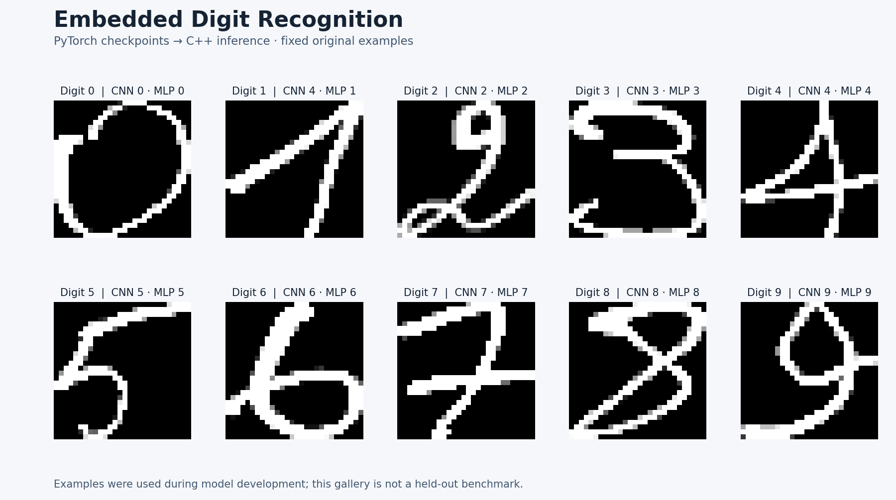

# Embedded Digit Recognition

[](https://github.com/amersaidi2002-byte/projet_mnist/actions/workflows/ci.yml)


**Train in PyTorch. Run MLP and CNN inference in C++ on a Raspberry Pi.**

A complete path from handwritten digit images to an embedded video application:
preprocessing, model training, checked weight export, C++ inference and prediction
overlays. Both forward passes are implemented directly in C++; OpenCV handles
images and video, and GStreamer provides the original TCP streaming mode.



The gallery uses the first original example of each class, including a CNN error
on digit 1. These images were used during model development; this is a qualitative
demo, not a held-out accuracy benchmark. [Regenerate the figure](#development).

## What this project demonstrates

- **Embedded ML:** dense and convolutional layers implemented in C++17, with no
  PyTorch or other deep learning runtime in the deployed inference application.
- **Model integration:** the Python and C++ implementations share a preprocessing
  contract, and numerical tests compare their output logits.
- **Reproducible training:** seeded splits, separate validation and test sets,
  validation-based checkpoint selection, JSON metrics and parameter manifests.
- **Robust application code:** explicit input errors, checked weight files, safe
  handling of frames with no eligible contour, and shared video application code.
- **Usable entry points:** single-image prediction, local video processing, camera
  input and H.264/TCP streaming, plus CMake, Make and Docker builds.

## Try an image in Python

Python 3.11+ is required. These commands use the included checkpoints and custom
image archive; they do not train a model or download MNIST.

```bash
git clone https://github.com/amersaidi2002-byte/projet_mnist.git
cd projet_mnist
python3 -m venv .venv
source .venv/bin/activate
python -m pip install torch torchvision --index-url https://download.pytorch.org/whl/cpu
python -m pip install -r requirements.txt
python -m training.prepare_data
python -m training.predict --model cnn --image data/custom/0/digit_0.png \
  --light-foreground --output runs/prediction.png
```

The command prints JSON with the predicted digit, ten logits and a single-call
inference time. Logits are model scores, not calibrated confidence. Replace
`--model cnn` with `--model mlp` to use the other checkpoint. The example archive
contains **199 images**, organized into ten digit classes.

Use `--light-foreground` for the bundled white-on-black digits and MNIST.
Omit it for a dark handwritten digit on a light background. An image without an
eligible contour returns `{"detected": false}`.

## Build and run C++

On Debian, Ubuntu or Raspberry Pi OS:

```bash
sudo apt-get update
sudo apt-get install -y build-essential cmake pkg-config libopencv-dev
cmake -S . -B build -DCMAKE_BUILD_TYPE=Release
cmake --build build --parallel 2
ctest --test-dir build --output-on-failure

./build/digit_cnn_app --image data/custom/0/digit_0.png --light-foreground \
  --output runs/cpp-prediction.png
./build/digit_mlp_app --image data/custom/0/digit_0.png --light-foreground
```

Run these commands from the repository root. Each executable defaults to its
model's parameter directory under `inference_c/`. Use `--weights DIRECTORY` for
newly exported parameters. Neither binary needs Python at runtime.

The original per-model Makefiles are also supported:

```bash
make -C inference_c/CNN
make -C inference_c/MLP
./inference_c/CNN/app --help
```

To build and test only the numerical C++ code, without OpenCV:

```bash
cmake -S . -B build-core -DBUILD_VIDEO_APPS=OFF
cmake --build build-core --parallel 2
ctest --test-dir build-core --output-on-failure
```

### Video and camera input

```bash
./build/digit_cnn_app --video input.mp4 --output runs/annotated.avi
./build/digit_mlp_app --camera 0 --output runs/camera.avi
```

Local video output uses MJPG in an AVI container. Without `--output`, local
video/camera modes process frames and print a final throughput/inference summary;
they do not open a display window. Keep the output directory writable and present.
The application classifies one prominent contour per frame, not a sequence of digits.

### Original GStreamer TCP mode

Install the GStreamer tools and base/good/bad/ugly/libav plugins. OpenCV must have
been built with GStreamer support. An H.264 TCP source must already be listening
on localhost; the application connects to it rather than starting camera capture.

```bash
./build/digit_cnn_app --input-port 5000 --output-port 8554 --width 1280 --height 720
```

Input is H.264 on `127.0.0.1:5000`; annotated output is MPEG-TS/H.264 on
`127.0.0.1:8554`. Dimensions must match the input. Output binds to localhost;
remote access should be configured explicitly outside this application. The
original positional invocation `./build/digit_cnn_app 5000 8554 1280 720` also works.

## Train and export

Start a new training run on MNIST, which is downloaded on first use:

```bash
python -m training.train --model cnn --dataset mnist --data data/mnist \
  --epochs 10 --output runs/cnn-mnist
python -m training.train --model mlp --dataset mnist --data data/mnist \
  --epochs 10 --output runs/mlp-mnist
```

Each run records configuration, package versions, split membership, training
history, the selected `best.pt` and final `test_metrics.json` with accuracy,
per-class recall and a confusion matrix. MNIST's training partition is split
90/10 for training/validation; its official test partition is evaluated once
after checkpoint selection. CPU is the default; `--device cuda` is optional.

For a small offline training check using the bundled examples:

```bash
python -m training.train --model cnn --dataset custom --data data/custom \
  --epochs 2 --output runs/custom-check
```

The custom preparation command creates a seeded stratified 60/20/20 partition:
119 train, 40 validation and 40 test images. A new run may also use `--checkpoint
runs/cnn-mnist/best.pt` for fine-tuning. The original included checkpoints have
unknown split membership relative to this new partition: evaluating those models
on it would not establish held-out accuracy.

Export either model to little-endian float32 files for C++:

```bash
python -m training.export --model cnn --checkpoint runs/cnn-mnist/best.pt \
  --output runs/export-cnn
./build/digit_cnn_app --weights runs/export-cnn --image my-digit.png
```

For the MLP, use `--model mlp` and `digit_mlp_app`. Export checks tensor shapes and
finite parameters, and records file sizes and SHA-256 digests. New output directories
are required for data preparation, training and export to avoid mixing runs.

## Models and preprocessing

| Model | Architecture | Parameters |
|---|---|---:|
| MLP | 784 → 128 → 64 → 10, ReLU hidden activations | 109,386 |
| CNN | Two 5 × 5 single-channel convolutions + ReLU, then 784 → 10 | 7,902 |

Both receive a normalized 28 × 28 grayscale digit and return ten logits.
Preprocessing applies a 3 × 3 Gaussian blur, threshold 125, the largest contour
between 4 pixels² and 90% of the image, square centering and area resizing.
[Implementation and validation notes](docs/validation.md) explain what changed
and what the checks establish.

## Docker

One Dockerfile builds either model from the repository root:

```bash
docker build --build-arg MODEL=cnn -t embedded-digits:cnn .
docker run --rm embedded-digits:cnn --help
docker run --rm -v "$PWD/data:/data:ro" embedded-digits:cnn \
  --image /data/custom/0/digit_0.png --light-foreground
```

Use `MODEL=mlp` for the other application. The image defaults to help rather than
waiting for a TCP source. Hardware access and TCP network configuration depend on
the host; neither Docker image emulates a Raspberry Pi camera.

## Development

```bash
python -m pip install -r requirements-dev.txt
ruff check training tests scripts
ruff format --check training tests scripts
pytest -q
python -m scripts.render_demo
```

Build the C++ targets in `build/` before pytest to include cross-language parity
and C++ image tests. Those tests are explicitly skipped if the executables are
absent. GitHub Actions builds them and runs the Python tests, an offline training
check and both Docker build variants. No research dataset download is required.

| Path | Contents |
|---|---|
| `training/` | Maintained Python models, preprocessing, training, prediction and export; original checkpoints |
| `inference_c/common/` | Shared preprocessing, parameter loading, options and video application |
| `inference_c/CNN/`, `inference_c/MLP/` | Model forward passes, checked exported parameters and Makefiles |
| `tests/` | C++ core tests, PyTorch/C++ numerical comparisons and data/image regression tests |
| `notebooks/archive/` | Original academic notebooks, retained with their historical outputs |
| `docs/` | Validation notes and reproducible demo figure |
| [Original report](CR_IA_embarque.pdf) | Historical project report |

## Scope

This remains an academic embedded AI project. The original report and notebooks
refer to the original experiments; they are not benchmarks of this refactoring.
The supplied checkpoints are retained, and their C++ parameters have been exported
consistently. The current tests establish numerical agreement and workflow behavior,
not new model accuracy, target-board latency or robustness to different handwriting,
lighting and backgrounds. The streaming deployment still needs a Raspberry Pi
hardware check.
